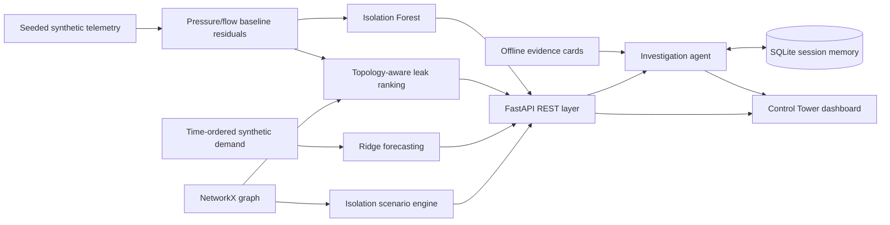

# AquaSentinel AI

### Agentic water-network digital twin for interpretable leak detection, resilience simulation, and evidence-grounded decisions

    

> **Original portfolio demonstration** — A complete end-to-end decision-intelligence application. Not connected to any real water company, pipeline, pump, SCADA device, customer record, or AWS account. No external LLM key is required. Agentic orchestration is deterministic and traceable.

## Why this is interesting

Water-network failures are **spatiotemporal**: an unexpected pressure dip alone cannot uniquely identify a leaking pipe. AquaSentinel combines an anomaly detector, a graph-distance residual signature, chronological demand forecasting, scenario analysis, and an auditable investigation agent into one interactive platform. Every step reports assumptions and supporting evidence, and there are no autonomous actions on physical equipment.

**Novel integration:** joint topology-aware incident ranking + time-ordered ML forecasts + what-if network isolation + a tool-using agent with explicit source citations and privacy-controlled session memory. This is an educational prototype, not a claim of unique algorithms or field-tested hydraulic accuracy.

## Features

| Capability | Implementation | Value |
|---|---|---|
| Network digital twin | NetworkX, 9 synthetic nodes / 14 pipes | Graph view and redundancy-aware path analysis |
| Telemetry generator | Seeded NumPy proxy model | Reproducible normal and incident sensors |
| Anomaly screening | IsolationForest on pressure/flow residuals | Alerts without fitting to incident labels |
| Leak localization | Weighted graph-distance signature matching | Ranked and explainable suspected pipes |
| Demand forecasting | Ridge regression, cyclical hourly features | 12–72h outlook and chronological holdout MAE |
| Scenario lab | Edge removal + Dijkstra paths | Isolation, disconnected customers and path stretch |
| Repair planning | Interpretable multicriteria ranking | Priority and crew-assignment proposal |
| Evidence retrieval | Offline TF-IDF with source IDs | Citations to safety and investigation reference cards |
| Investigation agent | Bounded local orchestration + tools | Multistep answers with explicit tools and no external LLM |
| Memory & guardrails | SQLite, session isolation, input rules | Recall preferences, clear history, reject bypass requests |
| Interactive dashboard | FastAPI + local HTML/CSS/JS/SVG | Responsive visualization without build tools |
| Reproducibility | Tests, Docker, optional CI | Run, inspect and extend the system |

## Quick start (Windows / macOS / Linux)

```bash
# From this directory
python -m venv .venv
# Windows: .venv\Scripts\activate
# macOS/Linux: source .venv/bin/activate
python -m pip install -e '.[dev]'
uvicorn aquasentinel.api:app --reload
```

Visit **http://127.0.0.1:8000** for the interactive dashboard, **http://127.0.0.1:8000/docs** for the Swagger API.

With Docker: `docker compose up --build` and open http://localhost:8000.

### Example API queries

```bash
curl http://127.0.0.1:8000/api/analyze
curl "http://127.0.0.1:8000/api/forecast?horizon=24"
curl -X POST http://127.0.0.1:8000/api/scenarios -H "Content-Type: application/json" -d '{"pipe_id":"P10","repair_hours":6}'
curl -X POST http://127.0.0.1:8000/api/agent -H "Content-Type: application/json" -d '{"session_id":"demo","message":"Investigate the leak and forecast demand"}'
```

### Tests & synthetic dataset

```bash
python -m pytest
python -m aquasentinel.demo --output data/synthetic_telemetry.csv
```

The demo event is intentionally injected into fictional pipe `P10` from hour 58 through 71. The inference pipeline is **not** given this label; it receives observed sensor residuals only. The inference ranks pipes using a heuristic, not calibrated probabilities. A reported detection or localization score does **not** imply field reliability.

## Architecture



Architecture and limitations: [docs/ARCHITECTURE.md](docs/ARCHITECTURE.md). Test and research methodology: [docs/MODEL_CARD.md](docs/MODEL_CARD.md). Optional future AWS integration (not implemented): [docs/AWS_ROADMAP.md](docs/AWS_ROADMAP.md).

## Design decisions

1. **No paid APIs by default.** Deterministic tool-using orchestration is inspectable and testable.
2. **Chronological ML evaluation.** Forecast test observations occur *after* the training period.
3. **No automation of physical controls.** The simulation can evaluate hypothetical closures, never actuate one.
4. **Separate reference data and incident data.** The anomaly model fits normal telemetry from a different seed.
5. **Explicit provenance.** Evidence cards have stable IDs; source citations can be inspected.
6. **Privacy-first demo.** No real user information, geo-coordinates, or utility blueprints.

## Security and limitations

- No authentication is provided; run locally or behind a trusted reverse proxy. **Do not expose publicly without authentication, rate limiting and storage controls.**
- Regex safety rules are illustrative and **not** a substitute for formal guardrails or human approvals.
- Telemetry comes from a simplified pressure/flow proxy, not a hydraulic solver (e.g. EPANET).
- Graph closure analysis detects connectivity/path stretch, **not** water quality or physically sufficient pressure.
- The exact synthetic generator also defines normal expectations. Real-world deployment would require calibration, independent validation, drift monitoring, incident labeling, and domain expertise.
- `SessionMemory` holds sessions locally in SQLite if `AQUASENTINEL_MEMORY_DB` is set; default is in-memory. Clear via `DELETE /api/sessions/{id}`.

## Project structure

```text
aquasentinel/
  api.py             REST API and dashboard hosting
  agent.py           Tool-based investigation with privacy guardrails
  detection.py       IsolationForest and graph signatures
  evidence.py        Cited offline retrieval
  forecast.py        Chronological demand forecasting
  memory.py          SQLite session memory
  network.py         Synthetic topology and shortest paths
  scenarios.py       Edge-isolation and repair planning
  simulator.py       Synthetic sensor generator
static/               Responsive dark control tower (no CDN)
tests/                Unit and API tests
docs/                 Architecture, model card, AWS roadmap
data/                 Exportable synthetic readings
```

## Portfolio talking points

> "I designed an end-to-end, privacy-first digital twin prototype that uses unsupervised anomaly detection and network topology to rank water-leak hypotheses, forecasts demand with chronological validation, simulates repair decisions, and orchestrates evidence-grounded investigative tools through a FastAPI interface. The dataset is synthetic, and the system is explicitly not a production hydraulic model."

### Author / attribution

Built as a portfolio engineering prototype for Ahmed Almufarriji. Code is openly inspectable under the MIT license. Educational, synthetic data only.
