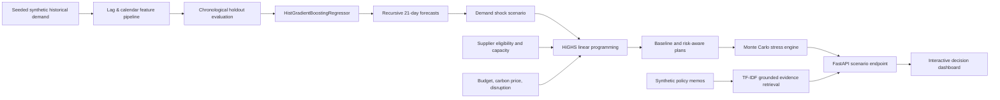

# Technical architecture

## Model evaluation contract

- Six independent SKU demand series, 490 days each, reproducible seed `20261019`.
- One-step holdout covers the most recent 70 calendar days across six SKUs.
- All lag and rolling features are shifted and reference observations strictly earlier than the predicted date.
- Seasonal naive comparison predicts demand with demand observed 7 days earlier.
- Recursive deployment forecasts use their own past predictions for future lag values, which raises forecast risk.
- Error bands are the 90th-percentile absolute **validation** residual by SKU, expanded heuristically over the horizon. These are **not conformal or statistically valid confidence intervals**.

## Optimization contract

For eligible supplier-SKU pair `(s,k)`, solve for nonnegative continuous planned procurement `q[s,k]` and SKU shortfall `u[k]`:

`min sum(q * (unit_cost + carbon_price * kg_CO2e / 1000 + risk_penalty + lead_penalty)) + 1000 * sum(u)`

subject to:

- `sum_s q[s,k] + u[k] >= max(0, 21-day forecast[k] - inventory[k])`;
- supplier total order quantities <= effective available capacity;
- each pair's quantity <= approximate on-time deliverable capacity;
- procurement cash cost <= budget;
- total unmet units <= (1 - service_target) * total replenishment need, **if feasible**.

If strict service feasibility fails, re-solve without the strict service bound and report `service_target_feasible=false` and all shortages. The optimizer is a **continuous LP**, not a discrete PO system; fractional units are intentionally exposed.

## Simulation assumptions

Each scenario runs a deterministic seeded set of trials. Supplier-wide late-delivery Bernoulli draws affect all items assigned to a supplier together; independent normal demand noise is applied per SKU. These probabilities and emissions are deliberately synthetic and must not be presented as calibrated empirical forecasts or verified carbon data. The two plans share a common random stream for comparability.

## Threat model / production gaps

This is an educational demonstration, not production infrastructure:

- No customer or operational data, secrets, real warehouse API or real purchase-order writes.
- No user authentication or access control. Do not host this demo with confidential data.
- No durable database, event bus, audited approval workflow or idempotent order processing.
- No transaction-safe stock reservation or package-size/integer purchasing.
- No external LLM. TF-IDF returns verbatim supporting snippets with file citations, not generated answers.
- No claims of statistically calibrated probability, causal identification or guaranteed service level.

## Recommended AWS production evolution (not implemented)

`API Gateway + Cognito -> Lambda/Fargate -> S3 + Glue -> SageMaker/Bedrock AgentCore -> DynamoDB/RDS -> CloudWatch` with Guardrails, KMS, scoped IAM, VPC endpoints, model/feature monitoring and mandatory human approval gates. This is a proposed architecture only.
