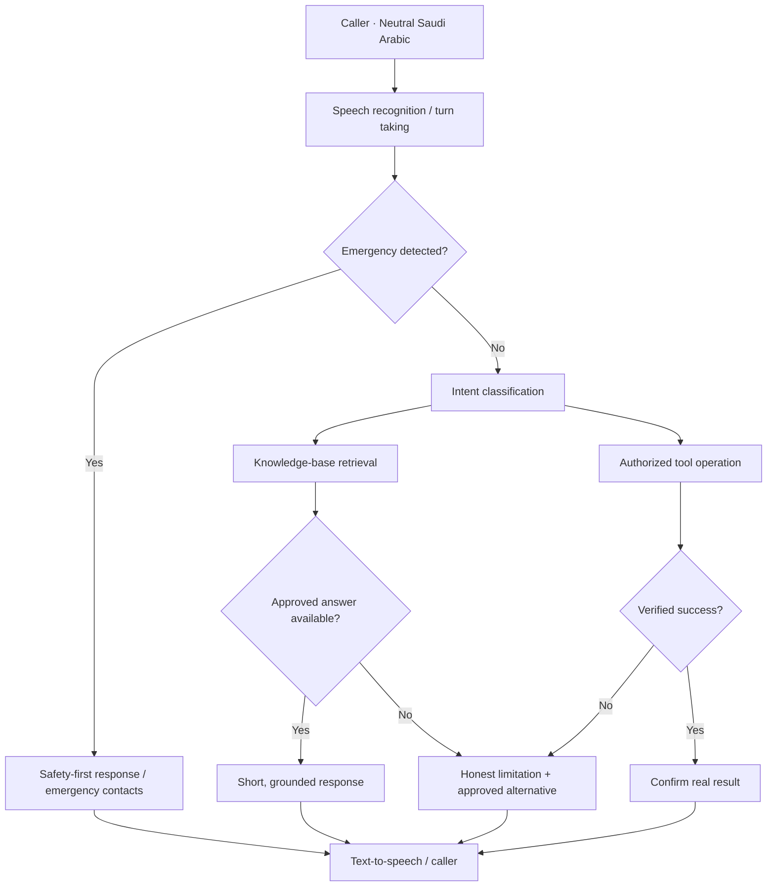

# Architecture and trust boundaries

SANAD is an **educational agent-engineering prototype** built for a hiring assessment context. It contains two distinct artifacts:

1. **Prompt specification** — intended to configure a real AI voice-agent platform with an approved knowledge base, real voice model, and authorized tools.
2. **Offline browser demo** — a scripted, deterministic conversation simulator for showcasing accident-intake workflows and safety branches. It is **not** an LLM, a live phone system, or a connected insurance service.

## Conceptual architecture

## Safety priorities

| Priority | Behavior | Avoid |
| --- | --- | --- |
| Immediate danger | Interrupt normal workflow; prioritize appropriate emergency assistance | Asking for policy details before urgent safety guidance |
| Facts | Use approved KB and successful authorized tool outputs | Invented claim status, branch, wait time, or compensation |
| Consent and privacy | Collect the minimum data needed; verify before protected lookups | Asking for OTP, PIN, or another person's private information |
| Action integrity | Confirm inputs and tool success before saying an action is completed | "Your report has been filed" with no confirmed report |
| Escalation | Offer actual handoff if available; otherwise provide official channels | Claiming a successful transfer with no transfer tool |
| Voice UX | Short responses, one question at a time, deliberate pauses | Repetitive formal scripts or interrupting numeric input |

## Agent prompting decisions

- **Separate personality from policy.** Friendly Najdi-neutral expressions must not override factual limitations.
- **Make emergencies an explicit top-priority branch.** "No injuries" does not cancel a separate fire or fuel hazard.
- **Treat tools as optional integrations.** Documentation describes what a production tool *would* do without pretending it exists in the prototype.
- **Handle errors gracefully.** The Nora patch is a concrete example of prompt-only degraded mode during a known dependency outage.
- **Evaluate different failure modes.** Safety, claim grounding, handoff, incomplete number capture and unsupported services need independent tests.

## Production gaps

A real Najm deployment would require organizational approvals, source-maintained knowledge, identity verification, live reporting and status APIs, recording consent, retention controls, human routing, measured Arabic ASR/TTS quality and security reviews. The browser demo does not implement these services.

### Official reference links

- [Najm](https://najm.sa/)
- [Najm accident reporting](https://najm.sa/report-accident/)
- [Saudi government emergency contacts](https://my.gov.sa/en/emergency-contact)
- [Taqdeer](https://taqdeer.sa/)
- [ElevenLabs Agents prompting guide](https://elevenlabs.io/docs/eleven-agents/best-practices/prompting-guide)
- [Anthropic Claude Cookbooks](https://github.com/anthropics/claude-cookbooks)

Operational details must be re-verified against the responsible organization's approved KB before real-world use.
