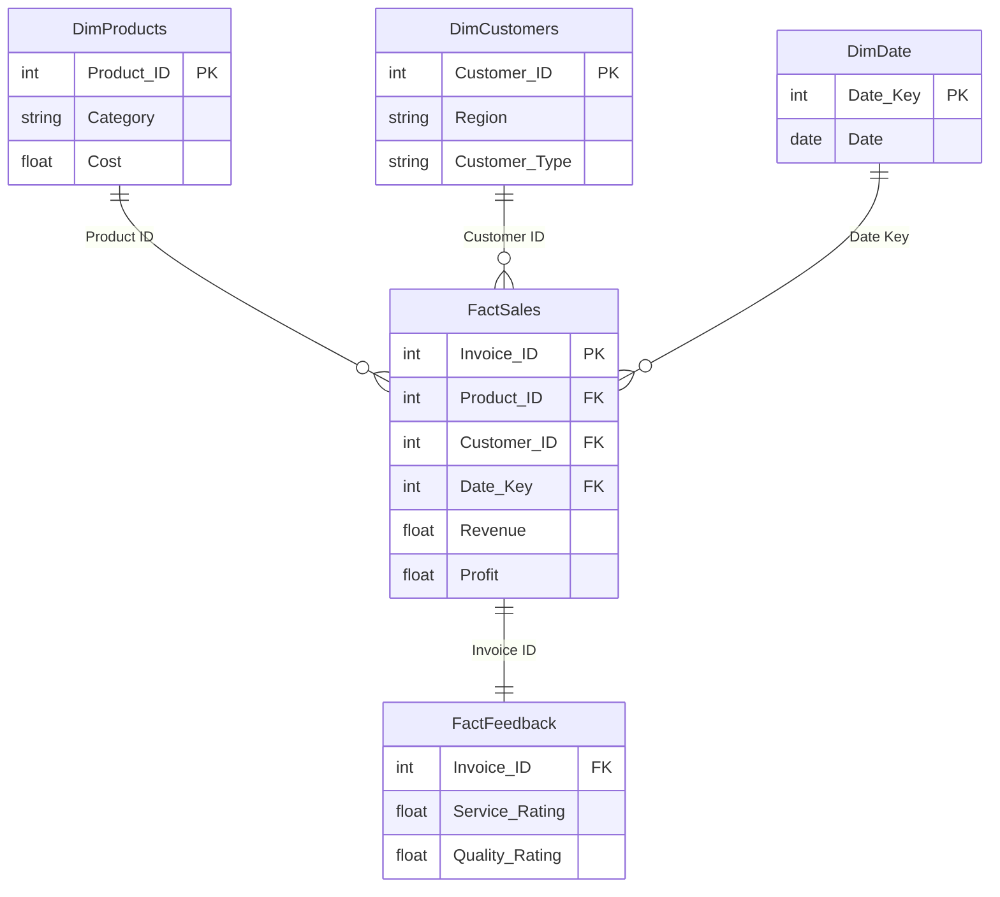
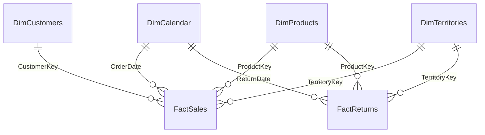
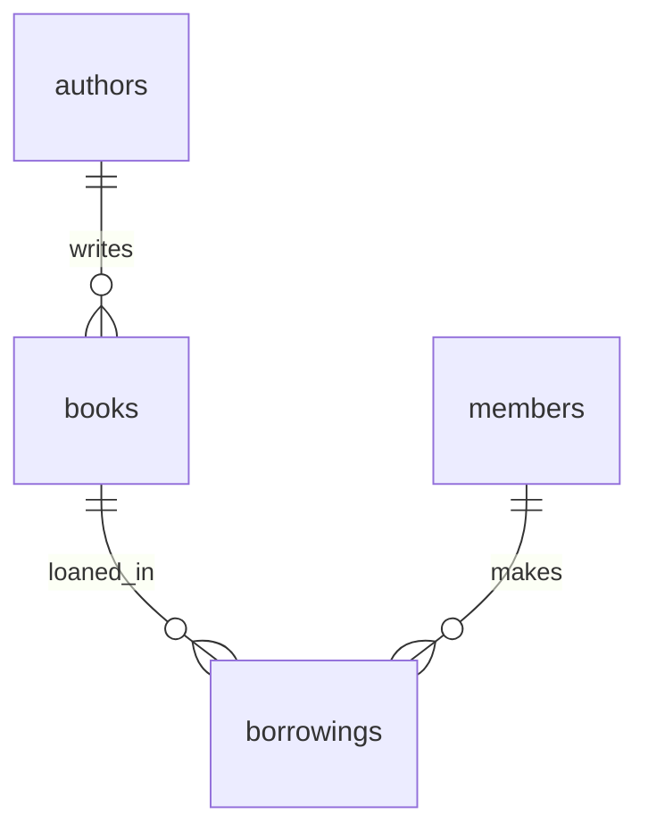
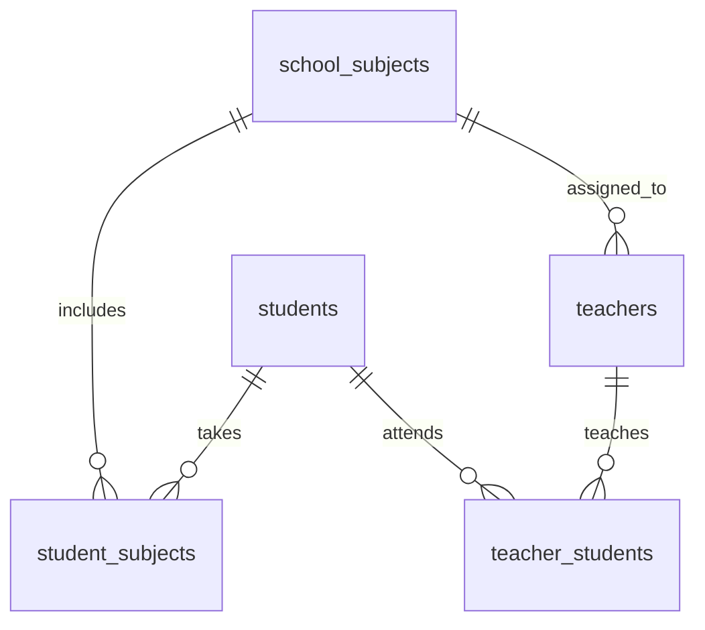

# Architecture sketches for selected projects

These diagrams summarize the relationships present in the course projects. They are conceptual aids, not an automatic migration or a Power BI `.pbix` export.

## Retail BI — star schema

Data classification is based on linked product/customer dimension tables. Refer to [retail DAX definitions](../05-business-intelligence/powerbi-store-satisfaction/dax/measures_and_columns.txt). Business metrics come from an educational dataset; the underlying raw customer records are withheld from this public repository.

## AdventureWorks BI — dimensional model

In the model, the calculated column is `FactSales[Gross Profit]` and the associated total measure is `[Total Gross Profit]`; `[Gross Margin %]` correctly references the latter. See the [implementation guide](../05-business-intelligence/powerbi-adventureworks-sales/docs/implementation.md).

## Electronic library — MySQL relational model

[Source SQL](../04-databases/mysql-electronic-library/sql/library_management.sql) includes primary keys, foreign keys and stored procedures. This is an educational local schema, not a deployed borrowing service.

## School management — many-to-many relationships

The school course also uses renamed tables across SQL levels. Run the [combined script](../04-databases/mysql-school-management/sql/school_management_levels_1_to_3.sql) in sequence on a disposable test database.
